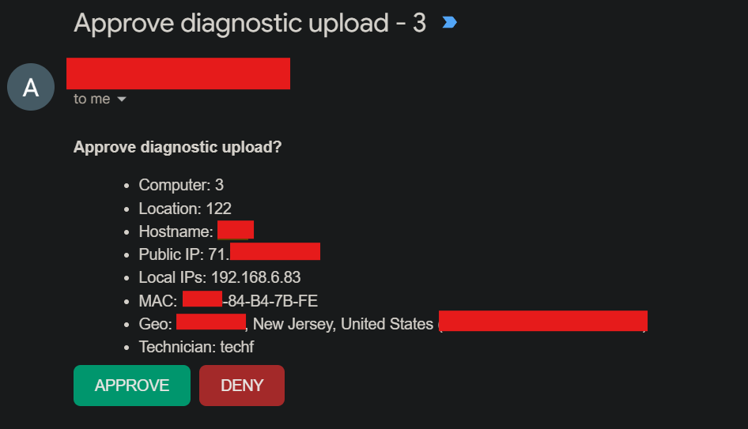

# segdiagdrop - Workstation Maintenance and Diagnostics Tool

A PowerShell tool for doing low-level maintenance and safety checks on Windows
computers used in a supervised program. Scans a machine, offers to fix and
clean things, and uploads a single diagnostic report to your private Google
Drive after you approve it from your phone with a free and secure Google Apps Script backend. Nothing sensitive is stored on the
computer it runs on. Perfect for any kind of nonprofit needing free, open-source, and easy software to manage many computers at once periodically, and easily.

---

## How it works, abbreviated

1. You run one launcher file from a USB stick.
2. The launcher pulls the current script from your GitHub repo (or whereever you want it stored online) and runs it *in
   memory* - nothing is written to the machine's disk.
3. The script asks for a password only you know, then a few intake questions.
4. It scans the machine (disk, drive health, files, software, startup, browser,
   security) - all read-only, changing nothing.
5. It offers to fix/clean/remove things - you confirm each one.
6. It asks what you fixed, builds one report, and sends it to your endpoint.
7. If your password you entered before was correct, your phone gets an email with the machine's details and an **Approve / Deny** button. Only when you Approve does the report save to your Drive. If the password was incorrect, it asks if you'd like to save a local report, and never touches your Drive or Gmail account.
8. On exit, every temporary file is securely wiped. Nothing is left behind.

<p align="center"></p>

[View an example diagnostic report](src/examplediag.md).

---

## The three moving parts

| Part | What it is | Where it lives |
|---|---|---|
| **`Invoke-PCMaintenance.ps1`** | The main script that does everything | Public GitHub repo |
| **`sqlite3.exe`** | A small tool, fetched only if you approve a deletion | Same GitHub repo |
| **`DiagnosticDrop.gs`** | Google Apps Script: checks your predefined, script-specific password, emails you the approval, saves the file to Drive | script.google.com |
| **`RUN-MAINTENANCE.cmd`** | Tiny launcher that starts the whole thing | Your USB stick |

The GitHub repo is **public and contains no secrets**. The only secret is your password, which you type at runtime and which is double-checked by the Google side, or an email that you must manually approve for the diagnostic file to be saved to your Drive. **The reason that `Invoke-PCMaintenance.ps1` isn't on the thumb drive is because this workflow was designed with swift use in mind. Meaning, a technician could go from computer to computer very quickly by simply plugging in the thumb drive, running the `.cmd` file, which would open the `.ps1` file via the public repo link, and then the technician could unplug the drive safely and move on, with the PowerShell script starting automatically once a password was typed in. Multiple thumb drives are not needed for this workflow, only one thumb drive and one person.

---

## Why nothing sensitive is exposed

- **The script and its URLs are not secret.** The endpoint URL is useless without your password.
- **Your password is never stored.** You type it each run, hidden. It is stored in memory only and is wiped on exit. The Google side stores only a one-way hash of it and rate-limits guesses (5 wrong tries locks it out), so a memorable password is safe.
- **The diagnostic never touches the machine's disk.** It's built in memory and uploaded. (If upload fails, you're *offered* a local save to the Desktop.)
- **Saved passwords flagged by the script are never read.** The browser check only sees *which sites* have saved logins, by domain - never the passwords themselves.

---

## What the scan looks at
*All of the following is customizable by modifying the PowerShell script. This was the script that worked for me in the environment I used it in, but you may be different with your use case.*


- **System summary** - OS, model, CPU, RAM, uptime, memory pressure
- **Disk usage** - flags any drive over 50% full
- **Drive health (SMART)** - SSD wear, temperature, failure prediction, disk errors
- **Files** - Desktop + Downloads, flagging large/stale/executable/suspicious files
- **Installed software** - full list + recent installs
- **Flagged software** - junkware, scareware, remote-access tools, miners, etc.
- **Games + unauthorized software** - game launchers, VPNs, torrent clients, etc.
- **Startup apps** - everything set to run at boot/login
- **Browser** - risky extensions, hijacked settings, dangerous domains in history,
  inappropriate content (for safeguarding), and saved-login domains
- **Security posture** - Defender, firewall, BitLocker, pending reboots
- **Temp/cache** - reclaimable space
- **Windows Update** - pending updates

**These flagged thresholds can be modified in the PowerShell script.**

## What it can fix/remove (only after you confirm each)

- Delete flagged files from Desktop/Downloads
- Uninstall games and unauthorized software (shown as a list first)
- Remove saved financial or inappropriate-site logins (by domain)
- Clear inappropriate browsing history (preserved in the report first)
- Install Windows updates
- Open Disk Cleanup
- **Recommended options** (multi-select): remove BitLocker, empty Recycle Bin,
  flush DNS, create a restore point, run SFC, disable hibernation, enable
  Storage Sense, restart

Everything destructive is opt-in, one prompt at a time, at the end of the run.

---

## Safeguarding

These machines may be used by minors, so the tool takes extra care:

- Inappropriate content (adult/gambling) found in history is recorded in a
  confidential section of the report **before** anything is deleted, so a record
  always reaches you even after cleanup.
- Report any illegal activity to law enforcement. Preserve any evidence of such activity.
- Make sure your program's overseers have approved this tool in writing before
  using it on real machines. It scans browsing and removes data on computers
  used by vulnerable people, which should be authorized, not improvised.

---

## One-time setup

### 1. Google Apps Script (Drive + approval)
1. Paste `DiagnosticDrop.gs` into script.google.com. You will fill in `FOLDER_ID`, `PASS_HASH`, `YOUR_EMAIL` with your own, accurate secrets.
2. Create a Drive folder. Copy its ID from the URL. Paste it into the appropriate spot on the `.gs` file.
3. Pick a password you'll remember. Compute its SHA-256 hash (this can be done on Windows, Linux, or MacOS; just Google it). Put that in the appropriate spot on the `.gs` file. If you forget that password, simply recalculate a hash of a password you know, and update it in the `.gs` file.
4. Deploy as a **Web app** in Google Apps Script: Execute as **Me**, Access **Anyone**.
5. Copy the `/exec` URL.


After **any** edit to the Apps Script, redeploy a **New version** or the old code keeps running.

### 2. GitHub (host the script + sqlite tool)
1. Put `Invoke-PCMaintenance.ps1` in a public repo.
2. Download the official **sqlite-tools** zip (not the DLL one), take `sqlite3.exe`, upload just that. This functionality is for database control on the script.
3. In the script's `$Config`, set `UploadEndpoint` (your `/exec` URL) and `SqliteToolUrl` (the raw `sqlite3.exe` URL). Leave `Password` empty.

### 3. The launcher
Put `RUN-MAINTENANCE.cmd` on your USB stick and set its `SCRIPTURL` to your raw
script URL.

---

## Running it on a machine

1. Double-click `RUN-MAINTENANCE.cmd` (right-click -> **Run as administrator**
   for full results).
2. A window opens rooted in the temp folder - **you can remove the USB now.**
3. Type your password (hidden), answer the intake questions.
4. Let the scan run; confirm each fix/removal at the end.
5. Answer "what did you fix?"
6. Your phone buzzes - tap **Approve** on the email.
7. The report lands in a dated `MM-DD-YYYY` folder in your Drive.
8. Press Enter; the screen clears and temp files are wiped.

---

## Health check

Confirm the Google endpoint is alive (no password needed):

```
https://YOUR-EXEC-URL/exec?action=ping   ->   {"ok":true,"alive":true}
```

---

## Good to know / limitations

- **Run as administrator** or update installs, BitLocker changes, SFC, restore
  points, and some checks won't work. To make this easier, you can change the CMD file to always ask for admin access so you don't have to right click on it every time.
- If a browser is open during the scan, the newest history entries might be missing from the read. Deletions close the browser first.
- The tool needs outbound HTTPS to GitHub, your Google endpoint, and (for geo) an IP lookup service. Locked-down networks may need these allowlisted.

---

## Inspiration
I decided to make secdiagdrop after I had been volunteering as an IT technician that would come in periodically for this one nonprofit. Since they have special needs adults consistently interacting with their computers, I would often have to delete malicious files or blocklist websites that they shouldn't be on. This tool made it insanely easier to go from computer to computer, as before I was doing the exact same thing on all of them: file and program deletion, Windows Defender scans, sensitive password scanning, check for updates, etc. secdiagdrop made it really easy, as I could do everything I needed to do in the script, and then that would generate a report file that would automatically go to my Drive, which I could share with the program coordinator. This allowed them to see anything I was doing, and I could also outline anything of concern (i.e. finding someone's banking password).


See the full blog post here: [https://aidanlenahan.com/blog/articles/secdiagdrop](https://aidanlenahan.com/blog/articles/secdiagdrop)